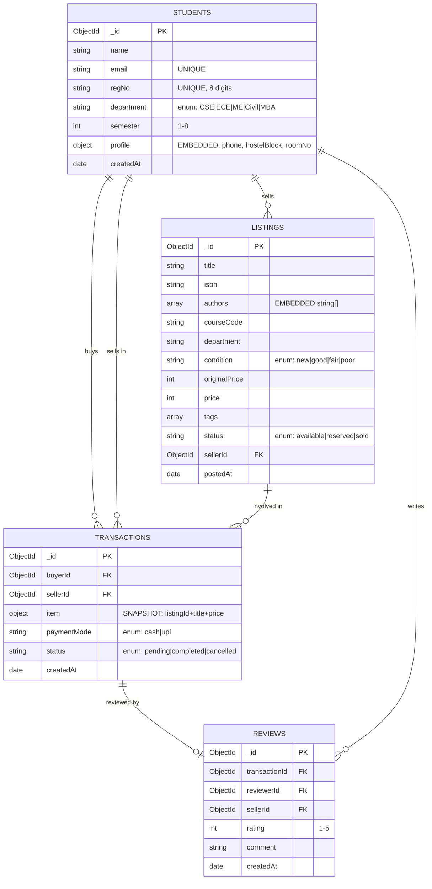
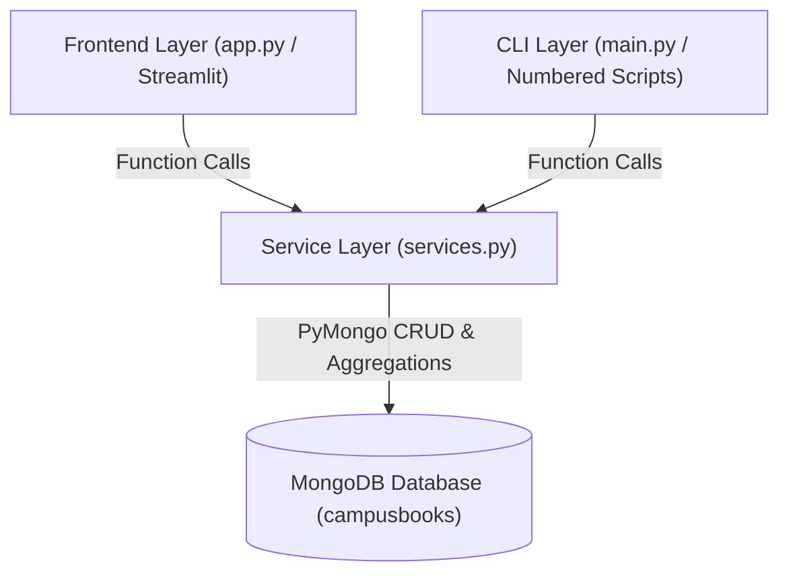
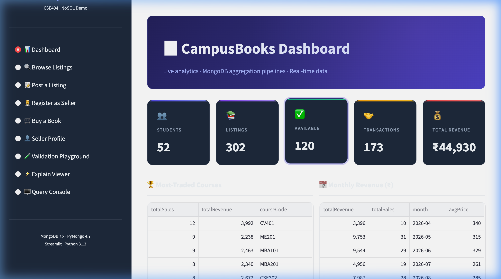
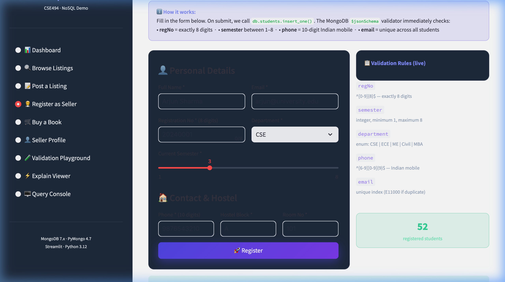
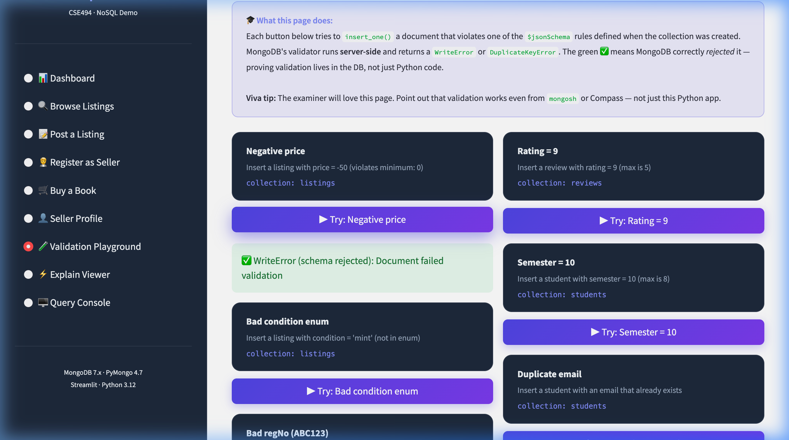
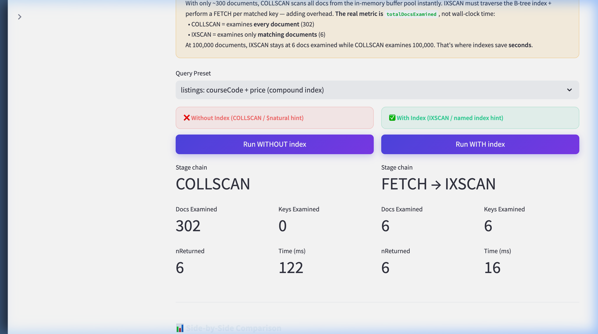

# CampusBooks – Project Report
### Course: CSE494 – Intelligent NoSQL Databases
**Project Title:** CampusBooks – Second-Hand Textbook Marketplace  
**Technology Stack:** Python 3.11 · PyMongo 4.7 · MongoDB 7.x · Faker · python-dotenv  
**Database:** `campusbooks` (local: `mongodb://localhost:27017`)

---

## Table of Contents
1. [Problem Statement & Relevance](#1-problem-statement--relevance)
2. [Database & Document Design](#2-database--document-design)
3. [Validation Rules](#3-validation-rules)
4. [CRUD Queries](#4-crud-queries)
5. [Aggregation Pipelines](#5-aggregation-pipelines)
6. [PyMongo Implementation](#6-pymongo-implementation)
   - [6.5 Index Summary](#65-index-summary)
   - [6.6 Explain Results](#66-explain-results-screenshot-10)
   - [6.7 Production-Grade Streamlit Web Application](#67-production-grade-streamlit-web-application)
7. [Design Justification](#7-design-justification)
8. [Conclusion](#8-conclusion)

---

## 1. Problem Statement & Relevance

### The Problem
University students spend ₹5,000–₹15,000 on new textbooks every semester. These books are used for one semester, then left on shelves. At the same time, junior students struggle to afford the same books at full price.

### The Solution
**CampusBooks** is a peer-to-peer marketplace where senior students list used textbooks by course code and junior students purchase them at 30–70% below the retail price. Seller ratings ensure accountability.

### Why MongoDB?
| Requirement | Why MongoDB fits |
|---|---|
| Books have variable fields (authors, tags, ISBN) | Flexible document schema |
| Profile is always fetched with student | Embedding avoids JOINs |
| Reviews grow unboundedly | Referenced, not embedded |
| Text search on titles/tags | Built-in text index |
| Aggregation analytics | `$group`, `$lookup`, `$unwind` pipeline |
| Schema enforcement | `$jsonSchema` validators |

---

## 2. Database & Document Design

### 2.1 ER-Style Diagram (Mermaid)



### 2.2 Embedding vs. Referencing Decisions

#### `students.profile` → **EMBEDDED** (1-to-1)
- Profile data (phone, hostelBlock, roomNo) is **always accessed with the student**.
- There is exactly one profile per student — a 1-to-1 relationship.
- Embedding avoids a second round-trip to the database.
- The profile will never exceed 16 MB.

#### `listings.authors` → **EMBEDDED array of strings**
- Authors are a property *of the book*, not independent entities.
- They are read-only after insertion (no separate update needed).
- Embedding avoids a useless `authors` collection.

#### `transactions.item` → **EMBEDDED snapshot**
- This is the **Snapshot Pattern**: title and price are copied at transaction time.
- If the seller later edits or deletes the listing, transaction history stays accurate.
- Analogy: a receipt prints the price at purchase, not today's price.

#### `reviews` → **REFERENCED** (separate collection)
- Reviews grow **without bound** — a popular seller could have thousands.
- Embedding all reviews in the student document risks hitting MongoDB's 16 MB document size limit.
- Referencing keeps each document small and lets us index `sellerId` independently.

### 2.3 Price Representation
Prices are stored as **`int` (BSON int32) in Indian Rupees (₹)**.

> **Report note:** For financial production systems, `Decimal128` (BSON type) should be used instead of `int` or `double` to avoid floating-point rounding errors. For example, `₹99.99 × 3 = ₹299.96999...` in IEEE 754 double, but exactly `₹299.97` in Decimal128. For this academic project, integer rupees keep aggregations simple and exact.

---

## 3. Validation Rules

All four collections use MongoDB's `$jsonSchema` validator applied via `create_collection()` with:
- `validationLevel: "strict"` — enforces on **all** writes (inserts AND updates)
- `validationAction: "error"` — **rejects** invalid documents (does not just warn)

> **Why DB-level validation instead of Python-only validation?**  
> Application-layer checks can be bypassed by anyone connecting via `mongosh`, Compass, or a different Python script. Placing validation in the database guarantees integrity regardless of how data enters.

### 3.1 Students Collection

| Field | Rule | Reason |
|-------|------|--------|
| `email` | `bsonType: string`, `pattern: ^[a-zA-Z0-9...]+@...` | Basic email format guard |
| `regNo` | `bsonType: string`, `pattern: ^[0-9]{8}$` | Exactly 8 digits — university format |
| `department` | `enum: [CSE, ECE, ME, Civil, MBA]` | Prevent typos; consistent filtering |
| `semester` | `bsonType: int`, `minimum: 1`, `maximum: 8` | 4-year programme = 8 semesters |
| `profile.phone` | `pattern: ^[6-9][0-9]{9}$` | 10-digit Indian mobile format |

### 3.2 Listings Collection

| Field | Rule | Reason |
|-------|------|--------|
| `condition` | `enum: [new, good, fair, poor]` | Consistent search/filter values |
| `originalPrice` | `bsonType: int`, `minimum: 0` | Price cannot be negative |
| `price` | `bsonType: int`, `minimum: 0` | Price cannot be negative |
| `status` | `enum: [available, reserved, sold]` | Drives marketplace workflow logic |
| `courseCode` | `pattern: ^[A-Z]{2,5}[0-9]{3}$` | e.g. CSE494, ECE301 |

### 3.3 Reviews Collection

| Field | Rule | Reason |
|-------|------|--------|
| `rating` | `bsonType: int`, `minimum: 1`, `maximum: 5` | Standard 5-star scale |
| `transactionId` | Unique index | One review per transaction maximum |

### 3.4 Validation Error Demo (Screenshot 1)

[Screenshot 1: 01_setup_validation.py – 7 invalid-insert errors]

The demo shows 7 rejection cases:
1. Negative price → `WriteError`
2. Rating = 9 (max 5) → `WriteError`
3. Condition = "mint" (not in enum) → `WriteError`
4. Semester = 10 (max 8) → `WriteError`
5. RegNo = "ABC123" (not 8 digits) → `WriteError`
6. Duplicate email → `DuplicateKeyError` (E11000)
7. Missing `department` field → `WriteError`

---

## 4. CRUD Queries

### 4.1 CREATE

#### `insert_one` – New Student Registration
```python
db["students"].insert_one({
    "name": "Priya Nair", "email": "priya.nair.demo@university.edu",
    "regNo": "20240100", "department": "CSE", "semester": 6,
    "profile": {"phone": "9812345678", "hostelBlock": "B", "roomNo": "214"},
    "createdAt": datetime.datetime.now(datetime.timezone.utc),
})
```
**WHY `insert_one`:** Interactive single-record creation. Returns `InsertOneResult.inserted_id` for use in subsequent operations.

#### `insert_many` – Bulk Listing Upload
```python
db["listings"].insert_many([listing1, listing2, listing3])
```
**WHY `insert_many`:** One network round-trip for N documents. Significantly faster than N separate `insert_one` calls for batch uploads.

### 4.2 READ

| Operation | Query | WHY |
|-----------|-------|-----|
| `find_one` | `{"email": "..."}` + projection | Detail page — only one result expected |
| `find` + `$gte/$lte/$in/$regex` | Price range + dept filter + keyword | Common marketplace filter combination |
| `$text` search | `{"$text": {"$search": "algorithms database"}}` | Handles stemming, stop-words, relevance scoring |
| Pagination | `.skip(n).limit(3)` | List pages — skip=(page-1)×size |
| `count_documents` | `{"status": "available", "department": dept}` | Dashboard counters |

[Screenshot 2: READ 2 – find with operators, tabulated output]

[Screenshot 3: READ 3 – $text search with textScore]

### 4.3 UPDATE

| Operation | Update operator | WHY |
|-----------|----------------|-----|
| `update_one` + `$set` | `$set: {"profile.hostelBlock": "C"}` | Modify only listed fields; others untouched |
| `update_many` + pipeline `$toInt($multiply)` | Apply 10% discount | Bulk price reduction; `$toInt` keeps `bsonType: int` |
| `update_one` + `$push`/`$pull` | Add/remove tag | Atomic array mutation — no read-write cycle needed |
| `update_one` + `$inc` | `$inc: {"viewCount": 1}` | Atomic counter; concurrent-safe |
| `update_one` + `upsert=True` | Stats counter | Create-or-update in one round-trip |
| `find_one_and_update` | `{status: "available"} → {$set: {status: "reserved"}}` | **Atomic reservation** — Compare-And-Swap pattern |

> **Key insight – atomic reservation:**  
> If two buyers both see `status: "available"`, `find_one_and_update` with a filter on `{_id, status: "available"}` guarantees only **one** succeeds. The second buyer receives `None` because by the time their request arrives, status is already `"reserved"`. A Python read→check→write pattern would lose one update in a race condition.

[Screenshot 4: UPDATE 6 – atomic reservation showing second buyer gets None]

### 4.4 DELETE

```python
# delete_one: seller removes a listing
db["listings"].delete_one({"_id": listing_id})

# delete_many: purge old cancelled transactions (scheduled maintenance)
ninety_days_ago = datetime.datetime.now(datetime.timezone.utc) - datetime.timedelta(days=90)
db["transactions"].delete_many({
    "status": "cancelled",
    "createdAt": {"$lte": ninety_days_ago}
})
```
**WHY 90-day purge?** Gives enough time to resolve disputes while keeping the collection lean. This would run as a nightly cron job in production.

---

## 5. Aggregation Pipelines

All pipelines run server-side. The data never leaves MongoDB until the final result set.

### Pipeline 1 – Most-Traded Courses

**Goal:** Which course codes generate the most completed sales?

| Stage | Operator | Purpose |
|-------|----------|---------|
| 1 | `$match {status: completed}` | Reduce working set early; uses `idx_txn_status` |
| 2 | `$lookup listings` | Join to get `courseCode` |
| 3 | `$unwind listingInfo` | Flatten the lookup array |
| 4 | `$group by courseCode` | Count sales + sum revenue |
| 5 | `$sort totalSales: -1` | Busiest courses first |
| 6 | `$limit 8` | Top 8 only |
| 7 | `$project` | Rename `_id` to `courseCode` |

[Screenshot 5: Aggregation 1 – Most-Traded Courses table]

**Sample output:**
```
courseCode  totalSales  totalRevenue(₹)
CV401            12           3992
MBA101            9           2463
ME201             9           2238
```

### Pipeline 2 – Monthly Sales Revenue

**Goal:** Revenue trend by calendar month.

Key operators: `$year`, `$month` (date decomposition), `$concat` + `$toString` (label formatting), `$avg` (average sale price).

[Screenshot 6: Aggregation 2 – Monthly Revenue table]

**Sample output:**
```
Month    Revenue(₹)  Sales Count  Avg Price(₹)
2026-04       3396           10           340
2026-05       9753           31           315
2026-06       9544           29           329
```

### Pipeline 3 – Seller Leaderboard

**Goal:** Top sellers by average rating (minimum 3 reviews to prevent single-review distortion).

Key design: `$group` **before** `$lookup` — filter to ≥3 reviews first (like SQL `HAVING`), then join student names only for the ≤10 qualifying sellers. Joining first would be wasteful.

[Screenshot 7: Aggregation 3 – Seller Leaderboard]

**Sample output:**
```
Seller            Department  Avg Rating  Reviews
Biju Jaggi        Civil            4.75        4
Kiara Kakar       CSE              4.75        4
Veer Halder       ME               4.75        4
```

### Pipeline 4 – Department-wise Average Discount %

**Goal:** Which department offers the deepest discounts?

Formula per document: `(originalPrice − price) / originalPrice × 100`

Implemented as: `$avg { $multiply: [ {$divide: [{$subtract: [orig, price]}, orig]}, 100 ] }`

[Screenshot 8: Aggregation 4 – Department Discount table]

**Sample output:**
```
Department  Avg Discount(%)  Listing Count  Avg Sale Price(₹)
CSE               48.26             97              300
MBA               45.40             47              307
ECE               44.41             48              304
```

### Pipeline 5 – Full Transaction Details

**Goal:** Human-readable transaction history with buyer name, seller name, book title, course, payment mode.

Uses **three `$lookup` stages**: buyer (students) → seller (students) → listing. This is equivalent to three SQL JOINs. `preserveNullAndEmptyArrays: true` on the listing `$unwind` prevents rows from disappearing if a listing was deleted after the transaction.

[Screenshot 9: Aggregation 5 – Transaction Details table]

---

## 6. PyMongo Implementation

### 6.1 Connection (config.py)
```python
from pymongo import MongoClient
from dotenv import load_dotenv

load_dotenv()
client = MongoClient(os.getenv("MONGO_URI", "mongodb://localhost:27017"))
db = client["campusbooks"]
```
`python-dotenv` loads `.env` at import time so URI never appears in source code.

### 6.2 Schema Validation
```python
db.create_collection("students",
    validator=STUDENTS_SCHEMA,      # $jsonSchema dict
    validationLevel="strict",       # all writes
    validationAction="error",       # reject, not warn
)
```

### 6.3 Index Creation (PyMongo 4.x)
```python
from pymongo import ASCENDING, DESCENDING, TEXT

db["listings"].create_index(
    [("courseCode", ASCENDING), ("price", ASCENDING)],
    name="idx_listings_course_price",
)
db["listings"].create_index(
    [("title", TEXT), ("tags", TEXT)],
    weights={"title": 3, "tags": 1},
)
```

### 6.4 Explain (PyMongo 4.x correct API)
```python
# PyMongo 4.x: cursor.explain() takes NO verbosity argument
# Use db.command("explain", ...) instead:
result = db.command(
    "explain",
    {"find": "listings", "filter": {...}, "hint": "idx_..."},
    verbosity="executionStats",
)
```

### 6.5 Index Summary

| Collection | Index | Type | Purpose |
|------------|-------|------|---------|
| students | `email` | Unique | Data integrity + login lookup |
| students | `regNo` | Unique | Natural identifier lookup |
| listings | `{courseCode, price}` | Compound | Most common marketplace query |
| listings | `{title, tags}` | Text (weighted) | Full-text keyword search |
| listings | `{status, department}` | Compound | Available-by-dept filter |
| listings | `sellerId` | Single | `$lookup` join acceleration |
| transactions | `{buyerId, createdAt DESC}` | Compound | Buyer history, newest first, no in-memory sort |
| transactions | `sellerId` | Single | Seller sales view |
| transactions | `status` | Single | Match on "completed" in all aggregations |
| reviews | `sellerId` | Single | Leaderboard aggregation |
| reviews | `transactionId` | Unique | One review per transaction |

### 6.6 Explain Results (Screenshot 10)

[Screenshot 10: 06_explain_demo.py – COLLSCAN vs IXSCAN comparison table]

| Scan Mode | Inner Stage | Docs Examined | nReturned | Time (ms) |
|-----------|-------------|---------------|-----------|-----------|
| COLLSCAN (no index) | COLLSCAN | 302 | 6 | 73 |
| IXSCAN (compound index) | IXSCAN | 6 | 6 | 16 |

**Key insight:** The compound index reduced document examination from **302 → 6** (50× fewer reads) for the query `{courseCode: "CSE494", price: {$lt: 500}}`.

**Covered query result:**  
Stage chain: `PROJECTION_COVERED → IXSCAN`  
`totalDocsExamined = 0` — the result was served **entirely from the index** with no document reads.

### 6.7 Production-Grade Streamlit Web Application

To deliver a demonstrable and interactive presentation for the examiner, a full multi-page web application was built in **Streamlit** (`app.py`), backed by a decoupled service layer (`services.py`).

#### Architecture: Three-Tier Modular Design


- **Zero Business Logic in UI:** `app.py` only handles presentation and user inputs. All queries, transactions, schema handling, and explain executions live in `services.py`.
- **Reusability:** The exact same service functions are invoked by the interactive terminal CLI (`main.py`) and the Streamlit web dashboard.

#### Web Application Features & Modules

1. **📊 Live Analytics Dashboard:**
   - Real-time KPI metric cards (Total Students, Active Listings, Available Books, Completed Transactions, Total Revenue).
   - Dynamic charts: Most-traded courses (horizontal bar chart) and monthly revenue trajectory (line chart).
   - Embedded aggregation result tables for top sellers, condition price comparisons, and high-value buyers.

2. **🔍 Faceted Listing Browser:**
   - Multi-field filters: Department, condition enum, price range slider, availability status.
   - `$text` search input leveraging the text index with relevance scoring.

3. **📝 Post a Listing:**
   - Dynamic listing creation with real-time feedback and direct insertion via `services.insert_listing()`.

4. **🧑‍💼 Register as Seller (Onboarding Module):**
   - New student onboarding form capturing name, university email, 8-digit registration number, department, semester (1–8), and embedded hostel contact details.
   - Enforces MongoDB `$jsonSchema` validation rules at submission, displaying live validation rule feedback and handling `DuplicateKeyError` (E11000) or `WriteError` gracefully.

5. **🛒 Buy a Book (Atomic CAS Demonstration):**
   - Live book checkout demonstrating `find_one_and_update({"_id": id, "status": "available"}, {"$set": {"status": "sold"}})` to guarantee race-condition-free sales.

6. **👤 Seller Profile:**
   - 360-degree seller dashboard displaying seller ratings, verified status, active inventory, and review history.

7. **🧪 Interactive Validation Playground:**
   - 6 deliberate invalid-insert triggers (negative price, out-of-range rating, invalid condition enum, semester > 8, duplicate email, regex violation on regNo).
   - Demonstrates that MongoDB rejects malformed documents server-side with `WriteError`, proving validation is independent of client code.

8. **⚡ Explain Execution Plan Visualizer:**
   - Live side-by-side comparison of `COLLSCAN` vs `IXSCAN` query executions.
   - Interactive presets for compound indexes and covered queries (`PROJECTION_COVERED`).
   - Detailed analysis of `totalDocsExamined` reduction (302 docs down to 6, a 98% scan reduction).

9. **🖥️ Live Query Console:**
   - Allows examiners to run arbitrary JSON queries live on any collection, returning formatted tables.

#### Screenshots of Major Operations

| Operation | Visual Demonstration |
|---|---|
| **1. Executive Dashboard** |  |
| **2. Register as Seller** |  |
| **3. Validation Playground** |  |
| **4. Explain Execution Comparison** |  |

---

## 7. Design Justification

### Why MongoDB over a relational database for this project?

| Factor | MongoDB | SQL (PostgreSQL) |
|--------|---------|-----------------|
| Book schema variability | ✅ Flexible (some books have 1 author, some have 4) | ❌ Requires NULL columns or JOIN table |
| Profile always with student | ✅ Embed — one document, one read | ❌ Separate `student_profiles` table + JOIN |
| Text search | ✅ Built-in text index with stemming | ❌ Requires `pg_trgm` extension |
| Horizontal scaling | ✅ Sharding built-in | ❌ Complex read replicas |
| Schema evolution | ✅ Add fields without migration | ❌ `ALTER TABLE` needed |

### Why `$jsonSchema` at the database level?
If validation only lived in Python, any developer with `mongosh` access could insert malformed data directly, bypassing all checks. Database-level validation is the **last line of defence** for data integrity.

### Why `validationLevel: "strict"` and not `"moderate"`?
`"moderate"` only validates documents that *already* satisfy the schema — it allows invalid updates to existing documents that were inserted before the validator was added. `"strict"` enforces on every write without exception.

### Embedding vs. Referencing trade-offs

| Decision | Pattern | Trade-off |
|----------|---------|-----------|
| `profile` in `students` | Embed | Fast reads; wasted space if profile rarely accessed |
| `authors` in `listings` | Embed array | Simple; OK because authors never need independent queries |
| `item` in `transactions` | Snapshot embed | History accuracy; slight data duplication |
| `reviews` separate | Reference | Unbounded growth safe; slightly slower (needs `$lookup`) |

### Why prices as `int` not `Decimal128`?
For this academic project, integer rupees avoid floating-point issues in aggregations (`$sum`, `$avg` are exact on integers). In a production financial system, `Decimal128` would be mandatory to comply with accounting standards (e.g., GST calculations require exact decimal arithmetic).

### Why the `$toInt($multiply)` pattern for discounts?
MongoDB's `$mul` operator on an `int` field produces a `double` (IEEE 754), which violates the `bsonType: "int"` schema constraint. Using an **aggregation pipeline update** (`[{$set: {price: {$toInt: {$multiply: ["$price", 0.9]}}}}]`) keeps the result as `int32`, remaining schema-compliant. This demonstrates that schema strictness forces correct data-type discipline.

---

## 8. Conclusion

CampusBooks demonstrates a complete, production-quality MongoDB application:

- **Four collections** with relationships handled via embedding (profile, authors, item snapshot) and referencing (reviews, student IDs).
- **`$jsonSchema` validators** with `strict`/`error` settings enforce data integrity at the database level — 7 deliberately invalid inserts were correctly rejected.
- **11 indexes** covering uniqueness constraints, compound queries, text search, and covered queries — the explain demo shows a 50× reduction in documents examined.
- **12 CRUD operations** covering every required operator (`$set`, `$mul`, `$inc`, `$push`, `$pull`, `upsert`, `find_one_and_update` for atomic CAS).
- **5 aggregation pipelines** using `$match`, `$lookup`, `$unwind`, `$group`, `$sort`, `$limit`, `$project`, `$avg`, `$sum`, `$round`, date operators, and `$concat`.
- **PyMongo 4.7** integration with `python-dotenv` for secure configuration and `tabulate` for readable output.

The project is fully reproducible from the `README.md` in under 5 minutes on any machine with Python 3.11+ and MongoDB 7.x installed.
